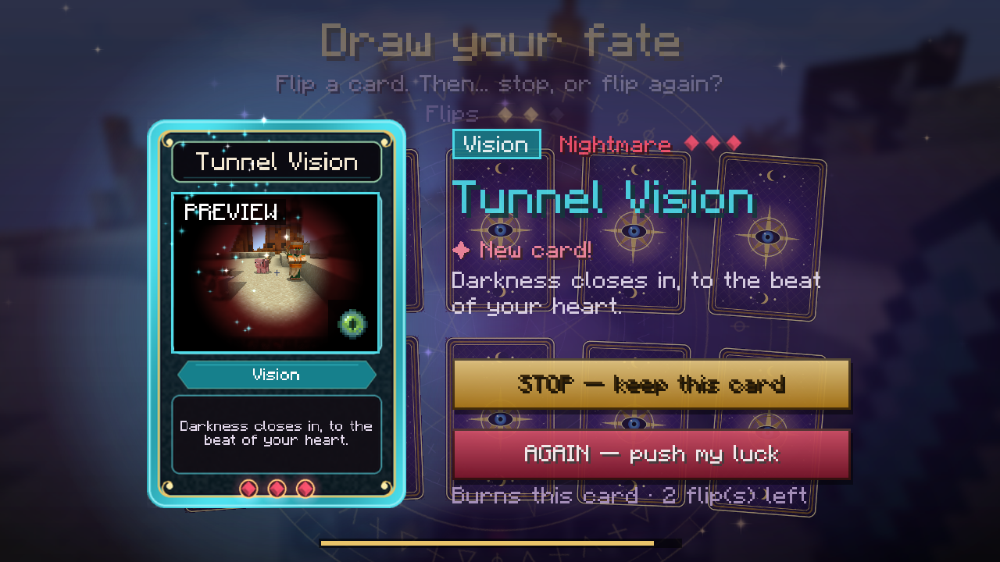

# Fiche CurseForge — textes prêts à copier

## Name

Fate Flip — Stop or Draw?

## Summary

Every 2 minutes, fate deals you 10 face-down cards. Flip one... then stop, or push your luck? 88 cards that twist how you see, hear and control Minecraft.

## Description (Markdown)

### Every two minutes, fate deals you ten cards.

They are face down. **Flip one.** You like it? **STOP** — it's yours until the next draw. It scares you? **AGAIN** — it burns, and you flip another... but you only get **three flips**, and **the last card you turn over always takes effect**.

Cards never touch the game itself — no stronger mobs, no free loot. They change **what you see, what you hear and how your controls respond**: a screen sliced into three strips that reshuffle every time you change hotbar slot, a self-scrambling sliding puzzle, thermal vision, echolocation, scrambled movement keys, every sound turned into an orchestra, a sarcastic narrator commenting on your every move...

**100% client-side**: works in singleplayer and on any server, even vanilla ones. Nothing to install on the server.

### ✦ The draw
- **10 different cards** every time — always ones you have **never seen** (then never played). Once you've played the whole deck, a new cycle begins.
- Each card shows its **family** and its **intensity** (1 to 3 gems: *Gentle*, *Strange*, *Nightmare*). That's your clue: stop, or push your luck?
- Screen-effect cards show a **live preview of your own view** through the effect, right on the card.
- Singleplayer pauses during the draw. In multiplayer you get 60 seconds, then fate chooses for you.
- Keyboard friendly: `1`–`0` to flip, `Enter` to stop, `Space` to go again.

### ✦ New in 2.0: Fate Powers
Daring pays off. Every card you keep earns **fate shards** ✦: +1 Gentle, +2 Strange, +3 Nightmare, **+1 for every AGAIN** you dared during that draw. Spend them during a draw on four powers, each once per draw:
- 👁 **Clairvoyance** (3 ✦): card backs reveal their family and intensity.
- 🍀 **Reprieve** (2 ✦): one extra flip.
- 🔥 **Phoenix** (4 ✦): a burned card rises from its ashes — take it back.
- ⏳ **Half Measure** (5 ✦): the card you keep only lasts half as long.

### ✦ The Grimoire (`K`)
Your whole collection, family by family: discovered cards, how many times you flipped and played each one.

### ✦ 88 cards, 5 families
| Family | Cards |
|---|---|
| **Space** | Triptych, Mirror, Down Under, Sliding Puzzle, Kaleidoscope, Vertigo, Vertical Video, Wandering Window, Meltdown, Whirlpool, Fisheye, Shattered, Video Wall, Droste Effect, Ripple, Glitch |
| **Vision** | Film Noir, Scarlet, Negative, Thermal Vision, 8-Bit, Pocket Console, Worn VHS, Old TV, 3D Glasses, Tipsy, Tunnel Vision, Sketchbook, Source Code, Psychedelic, Short-Sighted, Echolocation, Wet Lens, Comic Book, Cinemascope, Night-Vision Goggles, Colour Swap, Shadow Play, Stained Glass, Pointillism, X-Ray, Hologram, Miniature |
| **Mind** | Selfie, Barrel Roll, Spyglass, Ultra-Wide, Breathing World, Hiccups, Seasick, Dinnerbone, Paper World, Wonky Scale, Screensaver, Amnesia, Ghost Crosshairs, The Narrator, Enchanter's Glyphs, Heavy Eyelids, Eclipse, Deluge, Pea Soup, Party Time, Look Behind, Upside-Down HUD, Absurd Achievements, Zero Gravity, Disco Night |
| **Controls** | Scrambled Keys, Inverted Mouse, Steadicam, Triple Espresso, Capricious Hotbar, Crab Walk, Ice Rink, Input Lag, Leapfrog |
| **Hearing** | Helium, Deep Voice, Orchestra, Zoo, Paranoia, Echo, Dead Silence, Bad Dubbing, Crossed Ears, Warped Vinyl, Elevator Music |

**No cheating**: while a *Controls* card is active, the Controls screen (keys and mouse) is **sealed**. Cards never rewrite your saved key bindings — they only reinterpret your inputs while active, so nothing is ever saved or broken.

### ✦ Configuration
`config/fateflip-client.toml`: draw interval (default 120 s), first draw delay, effect duration, multiplayer choice timeout, cards per draw, max flips, **disabled cards**, `reduceFlashing`, `noMotionSickness`, controls lock, HUD corner.

Client commands: `/fateflip draw`, `/fateflip play <card>`, `/fateflip stop`, `/fateflip grimoire`, `/fateflip list`, `/fateflip reset`.

### ✦ Accessibility
Some cards distort, rotate or flicker the screen. If you are sensitive to flashing images or motion, turn on `reduceFlashing` and `noMotionSickness`, or disable any card with `disabledCards`.

### ✦ Requirements
Minecraft **1.21.1**, **Forge 52+**, Java 21. Client only.

---

### 🇫🇷 En français
Toutes les deux minutes, le destin vous tend **dix cartes face cachée**. Retournez-en une : **STOP**, elle s'applique jusqu'au prochain tirage ; **ENCORE**, elle brûle et vous en retournez une autre — trois retournements au maximum, et **la dernière carte retournée s'applique toujours**. 88 cartes qui changent ce que vous voyez, entendez et la façon dont vos commandes répondent, jamais la partie elle-même. Nouveau en 2.0 : les **Atouts du destin**. Chaque carte gardée rapporte des éclats ✦ (plus encore si vous avez osé dire « encore »), à dépenser pendant les tirages : Clairvoyance, Sursis, Phénix et Demi-mesure. Mod 100 % client, entièrement traduit en français. Grimoire de collection sur la touche `K`.

Source code & issues: https://github.com/Loup0007A/fate-flip — MIT licence.
